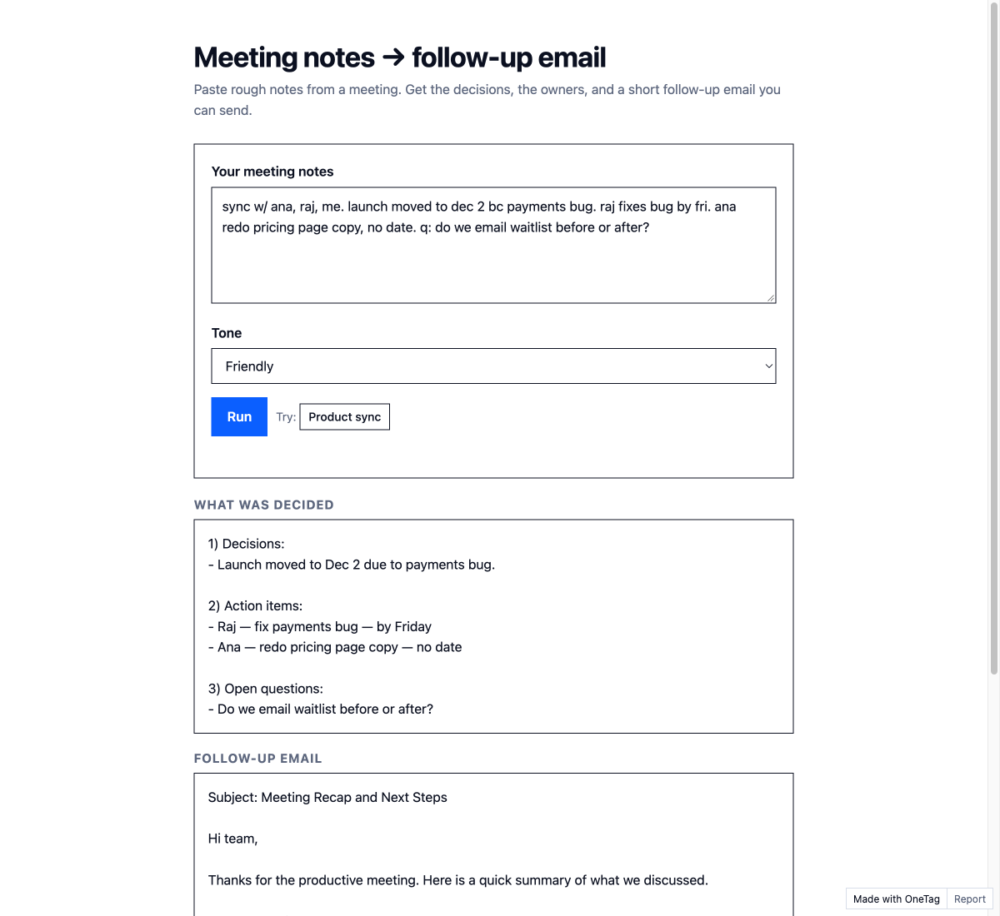

# go-public

**Turn a workflow you ran with your AI into a web page anyone can use. Visitors need no account and no API key.**

You got something working with Claude Code or Codex: a prompt, or a few prompts in a row, that take some input and produce a result. Say **"go public"**, and a minute later you have a link you can send to anyone. They open it, fill in the input, press Run, and get the result.

**[Live demo → p.onetagai.com/p4elqj](https://p.onetagai.com/p4elqj)**: meeting notes → decisions → follow-up email. Made with one "go public".



## Install

```bash
npx skills add fengyiqicoder/go-public
```

Other ways to install:

- **Claude Code plugin**: run `/plugin marketplace add fengyiqicoder/go-public`, then `/plugin install go-public@go-public`.
- **Gemini CLI**: `gemini extensions install https://github.com/fengyiqicoder/go-public`.
- **Any agent that reads skills**: copy `skills/go-public/` into its skills folder.

## What happens when you say "go public"

1. **Pin it down.** The agent writes the workflow down from your conversation: what a visitor types, the AI steps in order, and what they get back. You confirm it.
2. **Test it for real.** It runs a made-up example through the real AI and fixes any prompt that comes out vague.
3. **Publish.** It builds one HTML file and publishes it. You get a link.

To change the page, edit and say "go public" again: same link, new content. You can also take it down with one command.

## Why not just share a chat or an artifact?

| | Shared chat / artifact | go-public page |
|---|---|---|
| Visitor needs an account | Usually yes | **No** |
| AI usage billed to | The visitor's own plan | The page's free daily allowance |
| Visitor sees | Your conversation | A focused tool: inputs, Run, result |
| Works on any device and browser | Mostly | Yes, it's a plain web page |

## Limits, honestly

- **Allowance.** Each page has a free AI allowance per day and a per-visitor rate limit. A busy page that runs out says so and works again the next day.
- **No outside calls.** Pages run in a sandbox: no outside requests except the AI call, no forms that post anywhere, no logins or payments.
- **Safety checks.** Pages that ask for passwords, card numbers or codes are refused. Every page carries a small "Made with OneTag · Report" mark.

## Try the example locally

```bash
python3 skills/go-public/share.py try tests/example-workflow.json
```

## Privacy

To run the AI steps, the page and what visitors type go to [OneTag AI](https://onetagai.com). Prompts, inputs and answers are not stored. See https://onetagai.com/privacy.

MIT licence. Built by [OneTag AI](https://onetagai.com).
